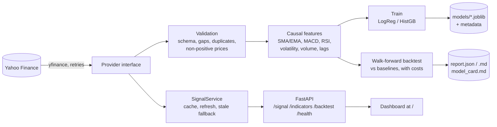

# cryptosignal: crypto technical analysis as an ML pipeline

[](https://github.com/zeineeb33/Crypto-bitcoin-technical-analysis/actions/workflows/ci.yml)

**Live demo:** https://cryptosignal-u2l4.onrender.com (free Render instance: the first request after a period of inactivity can take up to a minute while it wakes up) · [API docs](https://cryptosignal-u2l4.onrender.com/docs)

This project ingests daily BTC/ETH prices, validates them, and builds technical-indicator features with no look-ahead. It then trains next-day direction classifiers and evaluates them with a walk-forward backtest, against naive baselines and after transaction costs. The models are served from a FastAPI service with a dashboard, deployable on Render's free tier. **It does not claim to beat the market.** Daily crypto direction is close to a coin flip, and the backtest shows that. The point of the project is the engineering: reproducible data, leakage tests, honest evaluation, serving, CI and deployment.

## Architecture



The batch path (validation → features → train/backtest → artifacts) runs from the CLI and from a weekly GitHub Actions workflow. The service path (provider → cache → API → dashboard) runs in one web process.

## Features

- **Ingestion** behind a `MarketDataProvider` protocol (yfinance with retries and backoff, plus a CSV store), so it can be mocked or swapped. The ticker list is configurable (default `BTC-USD`, `ETH-USD`).
- **Data quality gate**: schema, ordering, duplicates, missing values, non-positive prices, negative volume, high < low, OHLC consistency, calendar gaps, extreme moves and staleness. The still-forming daily bar is dropped.
- **Features**: the original notebook's indicators (SMA, EMA 12/26, MACD, 7-day volatility, volume) plus RSI, lagged returns and momentum, all scale-free and **causal**. A test proves it: rewriting the future never changes features or walk-forward predictions at earlier dates.
- **Models**: regularised logistic regression (served by default) and scikit-learn HistGradientBoosting, with deterministic versions and JSON metadata.
- **Walk-forward evaluation** (expanding window, refit every 30 days, 10 bps per position change) against buy & hold, an SMA 50/200 crossover, the notebook's MACD crossover and a momentum rule. It reports accuracy with a 95% CI, ROC-AUC, total return, CAGR, Sharpe, max drawdown, exposure and trades.
- **Outputs**: `report.json`, `report.md` and a generated `model_card.md`.
- **Serving**: a FastAPI app with typed responses and OpenAPI docs at `/docs`, plus a dashboard at `/` (lightweight-charts) served by the same process.
- **MLOps**: CI (ruff, mypy, pytest with coverage and the network blocked, docker build and smoke test), a weekly train-and-backtest workflow that uploads its artifacts, Docker, and a Render Blueprint.

## Project structure

```
src/cryptosignal/
  config.py          typed settings (defaults < YAML < CRYPTOSIGNAL_* env vars)
  data/              providers.py, validation.py, ingest.py
  features.py        indicators, features, target
  models.py          model factory, training, persistence
  backtest.py        walk-forward, baselines, metrics
  report.py          Markdown report + model card
  pipeline.py        batch steps used by the CLI / workflow
  api/               app.py, service.py (cache), schemas.py, static/ (dashboard)
  cli.py             typer CLI: ingest, train, backtest, run, predict, serve
tests/               offline tests (synthetic data, fake provider)
notebooks/           the original exploratory notebook
.github/workflows/   ci.yml, pipeline.yml (weekly)
Dockerfile, render.yaml
```

## Quickstart

```bash
uv sync                                   # Python 3.12, locked dependencies
uv run cryptosignal run                   # ingest -> train -> backtest (writes data/, models/, artifacts/)
uv run cryptosignal predict -t BTC-USD    # latest signal from the saved model
uv run cryptosignal serve                 # http://127.0.0.1:8000 (dashboard), /docs (API)
uv run pytest --cov                       # tests (network disabled)
```

With Docker:

```bash
docker build -t cryptosignal .
docker run --rm -p 8000:8000 cryptosignal
```

Configuration lives in `src/cryptosignal/config.py`. You can override any value with environment variables, e.g. `CRYPTOSIGNAL_BACKTEST__COST_BPS=5` or `CRYPTOSIGNAL_TICKERS='["BTC-USD"]'`, or with a YAML file passed through `--config`.

## API

```bash
curl localhost:8000/health
curl localhost:8000/signal/BTC-USD
curl "localhost:8000/indicators/BTC-USD?days=90"
curl localhost:8000/backtest/ETH-USD
```

```json
{"ticker":"BTC-USD","as_of":"2026-10-20","prediction_for":"2026-10-21","probability_up":0.5177,
 "direction":"up","signal":"long","threshold":0.5,"model_kind":"logreg",
 "model_version":"logreg-20261019-9a72ef85","training_samples":4386,"data_source":"yfinance",
 "stale":false,"disclaimer":"Educational project - not financial advice."}
```

`/health` never calls the data provider. When Yahoo Finance is down, the API serves the last good snapshot (with `"stale": true`). If nothing is cached yet, it answers `503` with `Retry-After` and waits for a cool-down before retrying the provider.

## Backtest results

These numbers come from `uv run cryptosignal ingest && uv run cryptosignal backtest` with the default config, run on 2026-10-21 on Yahoo Finance data through 2026-10-20. The test is out-of-sample: BTC 2016-10-16 to 2026-10-19 (3,656 days, 52.2% up days) and ETH 2019-12-09 to 2026-10-19 (2,507 days, 51.9% up days). Every strategy is long/flat and pays 10 bps per position change.

| Asset | Strategy | Accuracy (95% CI) | ROC-AUC | Total return | Sharpe | Max drawdown |
|---|---|---:|---:|---:|---:|---:|
| BTC | Logistic regression | 51.6% (49.9-53.2) | 0.518 | 3,630% | 0.92 | -78.9% |
| BTC | HistGradientBoosting | 51.4% (49.8-53.0) | 0.518 | 1,219% | 0.75 | -84.4% |
| BTC | Buy & hold / always up | 52.2% | - | 12,814% | 1.06 | -83.4% |
| BTC | SMA 50/200 crossover | 51.1% | - | 8,498% | 1.08 | -69.3% |
| BTC | MACD crossover (notebook) | 50.1% | - | 11,204% | 1.26 | -51.3% |
| ETH | Logistic regression | 49.8% (47.8-51.7) | 0.513 | -27.3% | 0.24 | -88.1% |
| ETH | HistGradientBoosting | 51.5% (49.6-53.5) | 0.525 | 1,079% | 0.89 | -67.9% |
| ETH | Buy & hold / always up | 51.9% | - | 1,549% | 0.92 | -79.4% |
| ETH | SMA 50/200 crossover | 50.9% | - | 595% | 0.77 | -61.7% |
| ETH | MACD crossover (notebook) | 49.0% | - | 727% | 0.84 | -59.3% |

**How to read this:** neither model is statistically better than always predicting "up". Every accuracy CI contains the up-day rate, and ROC-AUC is about 0.52. After costs, neither model beats buy & hold on Sharpe or total return. On BTC, the simple trend rules (MACD and SMA crossovers) score higher Sharpe ratios and lower drawdowns, but that is one historical path, with no claim of robustness. The full tables, including a momentum baseline, are in `artifacts/report.md` after a run.

## Engineering decisions and trade-offs

- **Walk-forward, not a random split.** Shuffled K-fold leaks the future in time series. Every prediction uses a model fitted only on earlier rows, and scaling is fitted inside the pipeline on each training window.
- **Baselines and costs are first-class.** A model is only interesting if it beats always-up, buy & hold and simple rules after fees. Hyper-parameters were fixed a priori, with no tuning on the test period.
- **Leakage is tested, not assumed.** Property tests perturb future bars and assert that past features and predictions don't change. A deliberately leaky feature shows the guard works, and a positive control on autocorrelated data shows the pipeline can find signal when there is some.
- **Small image, no heavy ML stack.** I used scikit-learn's HistGradientBoosting instead of LightGBM, XGBoost or torch. There are no extra native libraries and memory stays low: about 160 MiB RSS in the container after warm-up, against Render's 512 MB limit.
- **Single-threaded math.** On a few thousand rows, BLAS/OpenMP threading was about 8x slower than one thread, and the target host has 0.1 CPU anyway.
- **The service trains at startup and does not ship model binaries.** Logistic regression trains in well under a second on about 4k rows, so the repo alone is enough to deploy. The batch pipeline still versions and persists models and uploads them as CI artifacts.
- **Stale-while-error caching.** A free-tier dyno must never crash-loop because a third-party API is flaky.

## Deployment on Render (free tier)

1. Push to GitHub, then go to the Render dashboard → **New** → **Blueprint** → select this repository. `render.yaml` defines a free Docker web service with `healthCheckPath: /health` and auto-deploy.
2. When the first request arrives (or the background warm-up runs), the service fetches data, trains and caches. It refreshes every 6 hours (`CRYPTOSIGNAL_SERVE__REFRESH_MINUTES`).

Measured locally with Render-like limits (`docker run --cpus 0.1 --memory 512m`), on a host that was busy with other jobs: image 547 MB uncompressed, about 160 MiB memory after warm-up, `/signal` in about 1 s, and the first `/backtest/BTC-USD` in about 12 s (then cached). Startup takes about 1.5 minutes because importing pandas and scikit-learn on 0.1 CPU is slow. Free services also sleep when idle, so expect a cold start.

## Roadmap

- Probability calibration and a tuned decision threshold, evaluated with nested walk-forward.
- Regime and volatility features, plus position sizing instead of long/flat.
- Experiment tracking (MLflow) and a model registry for the weekly pipeline.
- Bootstrap confidence intervals for Sharpe and drawdown.

## Background

This started as a personal/university notebook for analyzing Bitcoin prices (SMA, EMA, MACD signals, volatility, volume/price correlation, monthly performance). It is kept unchanged in [`notebooks/analyse_boursiere.ipynb`](notebooks/analyse_boursiere.ipynb). The package turns that exploration into a tested, deployable pipeline.

## Disclaimer

**Not financial advice.** This is an educational project. Past performance, especially in a backtest, does not predict future results.

## License

MIT, see [LICENSE](LICENSE).
